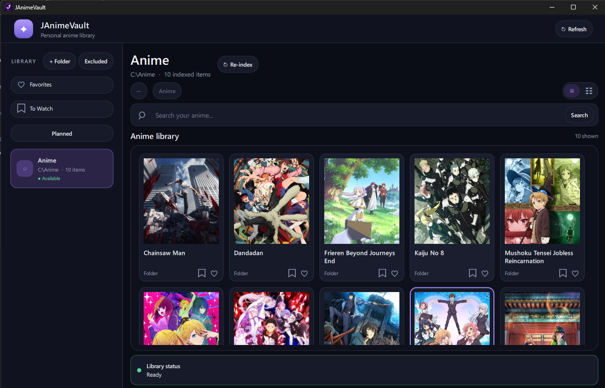

# JAnimeVault


**Your anime library, even when the drive is unplugged.**

JAnimeVault is a free, independent Python hobby project for organizing an existing
personal anime collection on Windows. Browse indexed folders offline, mark favorites,
keep track of unwatched titles, and plan what to obtain next. It is not an anime
downloader or streaming service.

Maintained by [JeisonOJ](https://github.com/JeisonOJ). Project version: **v1.0.0**.

## Library



## Features

- Index removable/USB drives and manually selected folders. Browse and search
  retained indexes even when a source is disconnected.
- Grid/List views, nested navigation, folder cover cards and compact file rows.
  Opening files and Explorer requires the source to be available.
- Independent **Favorites** and **To Watch** collections across indexed sources.
- **Planned** entries for future anime, including manual titles usable offline.
  Create, edit, search and remove them independently of drives.
- AniList cover discovery and caching, explicit candidate review and manual
  AniList URL linking for folders and Planned entries. Failed replacements retain
  the previous valid link. Requests use one FIFO worker with a four-second minimum
  API interval; uncertain matches can remain unlinked.
- Optional Edge/Chrome extension: capture selected text through a context menu,
  per-website floating button or popup. Native Messaging saves captures locally,
  even while the desktop application is closed.
- Import captures at startup, on entering Planned or with **Refresh imports**.
  Imported titles remain manual entries until explicitly linked.

Source labels, exclusions and organization do not rename or delete physical anime
files. Indexing stores metadata, not copies of media, and is not a backup or
continuous filesystem watcher.

## Requirements

- **Windows x64**, manually tested on Windows 11.
- **Python 3.14 x64**, tested with CPython 3.14.7.
- **PySide6 6.11.1**, pinned in [requirements.txt](requirements.txt).
- Windows PowerShell/Storage cmdlets for removable/USB drive detection.
- Internet access for dependency installation, new AniList lookups and covers.
  Indexed browsing, cached covers and manual Planned entries work offline.
- Optional: Microsoft Edge or Google Chrome with permission to load an unpacked
  extension and configure a per-user Native Messaging host.

The desktop uses Python, PySide6/Qt Quick/QML and SQLite. SQLite and networking use
Python's standard library; no database server is needed.

## Install and run from source

1. Install Python 3.14 x64, then download this repository's source or clone your
   chosen checkout. Extract it if needed.
2. Open PowerShell in the project directory containing `main.py`.
3. Confirm that `python --version` reports Python 3.14, then run:

```powershell
python --version
python -m venv .venv
.\.venv\Scripts\python.exe -m pip install -r .\requirements.txt
.\.venv\Scripts\python.exe .\main.py
```

Use a fresh `.venv`; do not overwrite an existing working environment. Activation
is not required. If `python` opens the Microsoft Store, select your installed Python
interpreter instead. Keep `ui`, `indexer` and `assets` beside `main.py`.

Use **+ Folder** to add a source, or connect a USB/removable drive. Connecting drives
can start indexing automatically. After changing a folder's contents, use
**Re-index selected**. Start with a small test folder if trying the app for the first
time. For console-free shortcuts, icons and taskbar setup, see the
[source launch guide](docs/windows_launch.md).

## Optional Edge/Chrome integration

The desktop works without the extension. To enable capture, load
[prototypes/native_messaging/extension](prototypes/native_messaging/extension)
through **Load unpacked** on `edge://extensions` or `chrome://extensions` with
Developer mode enabled. The extension currently displays **Planned Transport Test**,
version **0.3.0**; these technical names are retained for compatibility.

Copy the ID from your own browser's extension card/details. IDs may differ across
browsers, profiles, installations and computers. Then use the source setup script
with the same Python environment:

```powershell
# Edge example: replace the ID with the one shown in your browser
.\.venv\Scripts\python.exe .\prototypes\native_messaging\prepare_host.py --edge-id YOUR_EDGE_EXTENSION_ID --inbox production
```

This generates helper/configuration files; it does not register anything
automatically. Review the per-user registration before approving it. Full Edge,
Chrome and combined setup, ownership precautions and recovery are in the
[beginner extension guide](docs/browser_extension_setup.md).

The helper uses `python.exe`, not `pythonw.exe`, because Native Messaging needs
binary standard streams. Keep that Python environment available. Browser capture
has one pending unacknowledged message; **queued** is not delivery. **saved** or
**already_saved** confirms inbox storage, not Planned import. There is no automatic
AniList matching of imported captures. Site grants are needed only for the optional
floating button; selection alone never submits text.

## Data and privacy

Application data stays under `%LOCALAPPDATA%\ExternalDiskIndexer`:

| Path | Purpose |
| --- | --- |
| `index.db` | Indexes, sources, exclusions, marks, links, Planned and import receipts |
| `cache\covers` | Cached cover images |
| `logs\covers.log` | Cover diagnostics, not a general startup log |
| `imports\inbox` | Browser captures awaiting import |
| `NativeMessagingPrototype` | Source helper/configuration and separate test inbox |

Favorite/To Watch marks and links survive re-indexing and temporary disconnection.
Removing a source clears its marks and links without deleting physical media;
Planned remains independent. Close the application before backing up its data
directory. Databases, captures and receipts can contain private paths/text:
do not commit them or attach them to public bug reports.

## Troubleshooting

- **Startup error:** run the exact `python.exe main.py` command above in PowerShell
  and report the error and Python/Windows versions. Keep the complete source tree.
  Do not add unrelated Qt plugin paths or DLLs.
- **Unavailable drive:** retained indexes still work, but opening files and
  re-indexing require the source to be connected.
- **Missing cover:** requests are serial and matching is conservative. Use
  **Search AniList** or a valid AniList URL; see `logs\covers.log`.
- **Capture missing:** distinguish browser-queued, inbox-delivered and imported
  states. Retry the same UUID after fixing delivery, then enter Planned or use
  **Refresh imports**. See [import recovery](docs/browser_capture_import.md).

## Development and tests

Use the same virtual environment. Offline application tests use synthetic fixtures,
isolated databases and stubbed services:

```powershell
.\.venv\Scripts\python.exe -B -m unittest discover -s tests -p "test_*.py"
.\.venv\Scripts\python.exe -B -m unittest discover -s prototypes/native_messaging/tests -p "test_*.py"
```

Node.js is optional for additional mocked extension checks, not required for
desktop execution. The standalone `anilist_api_smoke.py` and
`anilist_cover_download.py` scripts are opt-in network diagnostics, not offline
test discovery targets. Never run normal application startup against personal
data merely to test a change.

## Development and AI Assistance

AI coding tools assisted with development, debugging, refactoring, testing and
documentation. Some visual assets were created with AI assistance. This disclosure
does not establish exclusive rights or replace review and attribution.

### Intended Use and Copyright

JAnimeVault is a local anime library organizer designed to help users catalog and manage their personal collections.

JAnimeVault does not download, distribute, or provide access to copyrighted anime episodes or other media files.

Users are responsible for ensuring that the content they manage complies with applicable copyright laws.

JAnimeVault is an independent hobby project and is not affiliated with or endorsed by anime studios, publishers, or distributors.

## ☕ Support the Project

JAnimeVault is a personal hobby project, developed with passion and shared freely as open-source software.

If you find it useful and would like to support its development, you can buy me a coffee. Any contribution is greatly appreciated and entirely voluntary!

☕ [**Support me on Ko-fi**](https://ko-fi.com/jeisonoj)

Your support motivates me to keep learning, improving my projects, and sharing new ideas with the community.

## License and acknowledgments

Original project code that the maintainer has the rights to license is available
under the [MIT License](LICENSE), **Copyright (c) 2026 JeisonOJ**.
Third-party software, anime artwork and external content retain their own licenses
and rights; the MIT grant does not automatically cover them.

Thanks to Python, PySide6/Qt, SQLite and AniList. Dependencies are installed into
your Python environment, not included as runtime libraries in this repository.
See [third-party acknowledgments](THIRD_PARTY_NOTICES.md) and
[licensing scope](docs/licensing.md). AniList access does not grant rights to
redistribute anime artwork, and no affiliation or endorsement is claimed.
